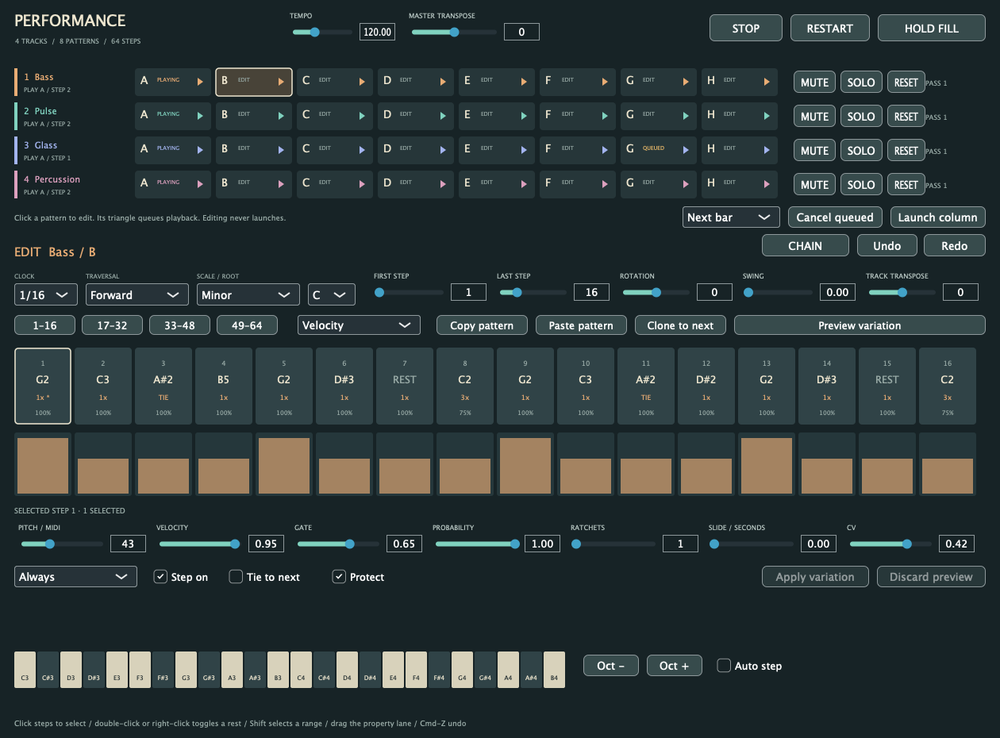
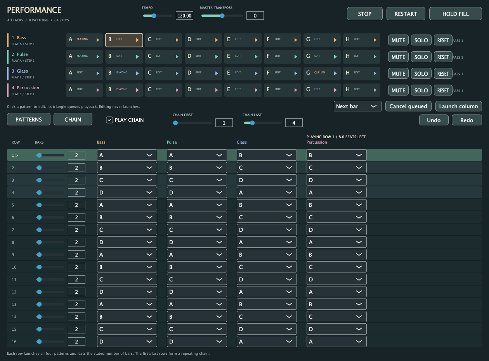

# Performance editor: native evidence, 19 November 2026

Request 54, build 0.0.9. These are screenshots of the actual JUCE component,
rendered by `createComponentSnapshot`, with actual engine playing/queued state.
They are not browser mockups. No desktop window peer or audio device was opened.
The minimum editor size is 1120×800; the larger capture is 1260×930.

The selected bank is Bass B while A plays. Glass G is queued; selecting/editing B
does not launch it. Pattern pages, property lane and selected-step inspector stay
in the same view. Clipboard, clone and variation actions name their scope. Playing
and queued banks use text as well as colour; mute/solo use coloured buttons. Selection remains independent
of the playhead. The lower keys enter pitches; Auto step advances the edit target.

Opening CHAIN does not arm it. PLAY CHAIN is explicit; first/last rows bound the
loop. Each row chooses four banks and a bar duration. The playing-row marker and
remaining beats come from DSP. Bank editing and queued launches remain accessible.

## Checks and corrections

Native actions verified: inactive-bank pitch edits, undo/redo preserving an
unrelated edit in track 4 bank H, copy/paste into another track, variation preview
without publication, protected steps surviving Apply, chain-duration editing and
undo, and a queued launch reflected by the engine without changing edit selection.
All patterns/chains and rendered audio also survive JSON recall.

The first capture exposed a clipped sixteenth chain row at minimum height and a
cramped final pattern-setting field. Row height and settings now use available
space. Tempo initializes before the first timer callback, and active transport
without a step reads WAITING FOR CLOCK. The final four images were inspected:

- [Pattern editor at minimum size](performance/performance-minimum.png)
- [Chain at minimum size](performance/performance-chain-minimum.png)

No clipped rows or overlapping controls remain in these captures. Small track
status labels are secondary to the labelled pattern pads; minimum-size targets
are denser than the normal view. Pointer feel, macOS window behaviour, physical
keyboard and audio-device operation remain desktop checks. Passing component tests
does not establish those properties or musical appeal.

Reference mapping and controls: [Performance contract](../architecture/PERFORMANCE_SEQUENCER.md).
Original source/UX research: [workflow comparison](sequencers/WORKFLOWS.md).
Exact binary/source/image hashes: [receipt](../verification/performance_build_receipt.json).
