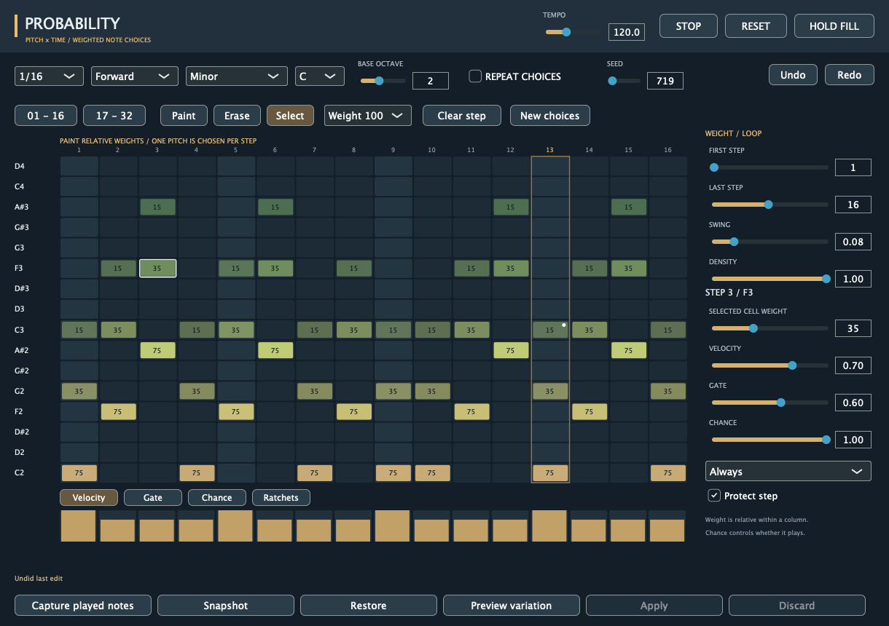
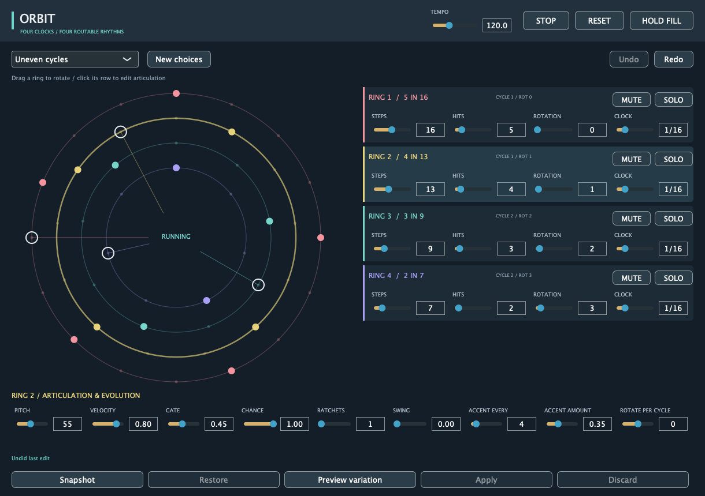

# Probability and Orbit — native interface evidence

Request 59, 0.0.12. Actual JUCE components rendered with engine playheads and
outcomes, without a desktop window peer or audio device. Normal size 1220×860;
minimum 1120×820. These are the implemented editors, not design mockups.

## Probability

The saved Stochas **T01** image guided the pitch × time representation and relative
weights. OXI **OX01/OX06** reinforced labelled axes and separation of pitch choice
from gate probability. Each column chooses one painted pitch; the inspector edits
its weight and step articulation. Row labels mute pitches. Four property lanes
share the horizontal time axis. The white dot marks the actual chosen pitch;
selection and playback remain distinct.

[Stochas source study](sequencers/stochas.md), [OXI source study](sequencers/oxi.md).
Neither dependency arrows/layers nor OXI's whole mode set are claimed here.

## Orbit

Bespoke **B03** guided four concentric Euclidean rhythms and their adjacent controls.
Ring colours connect the visual orbit, parameter row and articulation inspector.
Drag a ring to rotate its pattern; actual clock heads and per-cycle rotation are
DSP state. Clocks, lengths and note/gate/accent destinations are independent.
The CLOCK field shows musical divisions, not internal enum indices.

[Bespoke source study](sequencers/bespoke.md). No Bespoke source or artwork adopted.

## Interaction and visual review

Native checks exercise multi-cell painting as one undo operation, selection that
does not paint, redo, seed changes, protected variation preview/apply, snapshot
restore, capture matching actual played outcomes, and ring rotation/undo. The
same edited module supplies the captured playheads. Previews leave playback
unchanged until Apply. Both routed presets reproduce identical stereo audio after
JSON recall; each Orbit ring's destination is independently audible offline.

52 sliders in the two expanded editors and 811 other tested controls retain their
values and forward four wheel directions. Deliberate painting, rotation and value
entry still work. Every visible child fits within the minimum editor bounds;
footer actions are explicitly visible and tested there.

First captures exposed garbled UTF-8 dash labels, numeric clock enums and missing
Orbit footer actions. Final controls use legible labels and explicit footer
visibility/layout. The octave value now matches the MIDI note-name convention.
Five final captures were inspected: no clipped controls or overlaps were found.
Small secondary labels are still dense at the minimum size.

- [Probability at minimum size](reference-sequencers/probability-minimum.png)
- [Orbit at minimum size](reference-sequencers/orbit-minimum.png)
- [Protected variation preview](reference-sequencers/probability-preview.png)

Desktop window behaviour, physical pointer/keyboard feel, audio-device operation
and musical usefulness remain user checks. The previous unexciting-sequencer
feedback is not considered resolved by this verification alone.

[Mechanism and remaining models](../architecture/REFERENCE_SEQUENCERS.md),
[exact source/image/binary evidence](../verification/reference_sequencers_build_receipt.json).
